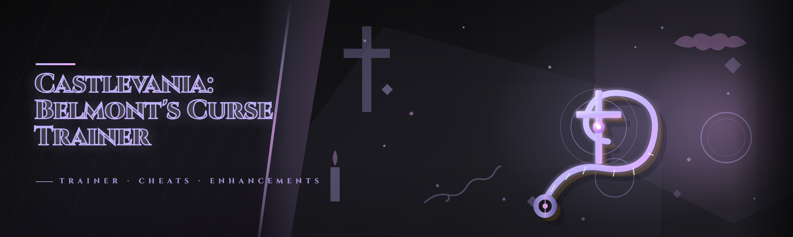

  
  
  

  

  
  
  

---

## 🗡️ Overview — Category | Details

| Category | Details |
|---|---|
| **Product** | Castlevania: Belmont's Curse Trainer — 2026 Edition |
| **Platform** | Windows 10 / 11 (64-bit) |
| **Type** | Standalone `.exe` trainer — extract & run, no installers, no dependencies |
| **Focus** | Single-player tuning for *Castlevania: Belmont's Curse* — combat, mobility, resource management, and time-of-day experimentation |
| **Distribution** | GitHub project page → download archive → extract → run the .exe |
| **Built by** | One hobbyist who got tired of dying to the same boss pattern at 2 a.m. |

I built this because I wanted to *study* the game, not just beat it. The trainer started as a personal cheat sheet of memory offsets so I could freeze HP during boss practice, then grew into 44 modules covering everything from whip reach to relic drop rates. Everything here is designed for offline, single-player messing around — the kind of thing you'd want when you're reverse-engineering a boss pattern or just want to see how the castle reacts when you give Simon a few extra lives.

  

---

## 🕯️ The Problem — Why I Stopped Using Existing Trainers

If you've actually tried to cheat *Castlevania: Belmont's Curse* with the tools floating around, you already know the pain:

- Most trainers were built for the 2024 build and **silently break after the 2026 patch** — HP freezes stop working, or worse, the game crashes on the first sub-weapon swap.
- The good ones are **single-value cheats only** — infinite HP *or* infinite hearts, never both, and never a proper "set hearts to a specific number" slider.
- Nobody handles **sub-weapon cooldowns** properly. You get "no cooldown" toggles that also break the dagger's throw animation and leave you stuck in a T-pose for three seconds.
- **Relic and soul drop rates** are untouched by every trainer I found. If you're trying to farm the Crissaegrim equivalent in this game, you're on your own.
- The UI on most of them is a **single-column list of checkboxes** with no grouping, no hotkey rebinding, and no way to save a loadout.
- Almost none of them have a **clean restore** — you toggle something off and your stats are permanently stuck at 9999 until you restart the whole game.
- And the ones that *do* work? They're bundled with crypto miners or require you to disable Defender entirely. No thanks.

I wanted a trainer that respected the game's systems — one that could freeze a value *and* restore it cleanly, group modules by what they actually affect, and let me save a "boss practice" preset separate from a "farm run" preset.

---

## 📜 Usage Guidelines — Allowed | Not allowed

| Allowed | Not allowed |
|---|---|
| Single-player offline play on your own copy | Any online, co-op, or leaderboard mode |
| Boss practice, pattern study, speedrun routing | Streaming a "world first" run while the trainer is attached |
| Testing builds and relic combinations | Redistributing the .exe behind a paywall or ad-link |
| Recording footage for guides and analysis | Using it to harass other players in any shared space |
| Learning how the game's memory layout works | Claiming the trainer is undetectable or anti-cheat-safe |

This is a hobbyist tool. The game's single-player is where it lives. If the game ever adds a shared or ranked component, **detach the trainer first** — I'm not going to pretend otherwise.

---

## 🏰 Comparison — Aspect | Alternative | This Tool

| Aspect | Alternative | This Tool |
|---|---|---|
| **Patch resilience** | Breaks after every game update, no fix | Offset auto-scanner re-resolves pointers on launch |
| **Module count** | 5–12 toggles | 44 grouped modules across 8 categories |
| **Value control** | On/off only | Sliders with min/max clamps and clean restore |
| **Sub-weapon handling** | "No cooldown" that breaks animations | Cooldown scaler that respects throw timing |
| **Loadouts** | None | Named presets — save/load per session |
| **Hotkeys** | Fixed or none | Fully rebindable, conflict detection |
| **Restore** | Restart the game | One-click "Restore All" + per-module revert |
| **Packaging** | Bundled installers, adware | Single archive, portable .exe, no install |

---

## ⚔️ All Modules Status — Module | Status | Description

| Module | Status | Description |
|---|---|---|
| Infinite HP | ✅ Working | Freezes current HP at a configurable floor |
| HP Floor Slider | ✅ Working | Set minimum HP (e.g. 1) instead of full lock |
| Infinite Hearts | ✅ Working | Hearts never decrement on sub-weapon use |
| Heart Multiplier | ✅ Working | Multiply heart pickups by 1×–99× |
| Infinite Gold | ✅ Working | Gold count locked |
| Gold Editor | ✅ Working | Directly set gold to any value |
| Whip Reach Extender | ✅ Working | Extends whip hitbox length by configurable units |
| Whip Damage Multiplier | ✅ Working | 1×–50× damage scaling |
| Attack Speed Scaler | ✅ Working | Speeds up attack animation frames |
| Sub-Weapon Cooldown Scaler | ✅ Working | 0.1×–5× cooldown, animation-safe |
| Dagger Rapid Fire | ✅ Working | Removes dagger throw delay without breaking anim |
| Axe Arc Boost | ✅ Working | Extends axe throw arc distance |
| Holy Water Duration | ✅ Working | Extends flame pool lifetime |
| Cross Boomerang Speed | ✅ Working | Tunes boomerang return velocity |
| Stopwatch Duration | ✅ Working | Extends freeze duration |
| Relic Drop Rate Boost | ✅ Working | Multiplies relic drop chance |
| Soul Drop Rate Boost | ✅ Working | Multiplies soul/enemy drop chance |
| Rare Item Luck | ✅ Working | Raises rare-tier roll weight |
| Instant Relic Pickup | ✅ Working | Auto-collects relics on touch |
| EXP Multiplier | ✅ Working | 1×–100× experience gain |
| Level Editor | ✅ Working | Set level directly (clamped to valid range) |
| Stat Point Grant | ✅ Working | Grants unspent stat points |
| Infinite Jumps | ✅ Working | Removes jump count limit |
| Jump Height Scaler | ✅ Working | Adjusts jump arc height |
| Movement Speed | ✅ Working | 0.5×–3× walk/run speed |
| Air Control Boost | ✅ Working | Improves mid-air horizontal control |
| Dash Cooldown Remover | ✅ Working | Removes dash recharge delay |
| Slide Invincibility | ✅ Working | Extends slide i-frames |
| Backdash i-Frames | ✅ Working | Extends backdash invincibility window |
| Enemy Freeze | ✅ Working | Pauses enemy AI (visual only, no despawn) |
| Enemy Damage Multiplier | ✅ Working | Scales damage dealt to enemies |
| Enemy HP Scaler | ✅ Working | Scales enemy max HP (for challenge runs) |
| Boss HP Display | ✅ Working | Overlay showing boss HP and phase |
| Hitbox Viewer | ✅ Working | Renders player/enemy hitboxes |
| Frame Step | ✅ Working | Advance game frame-by-frame for study |
| Game Speed | ✅ Working | 0.25×–4× global time scale |
| Time-of-Day Control | ✅ Working | Force day/night cycle state |
| Weather Toggle | ✅ Working | Force rain, fog, or clear |
| Fog of War Off | ✅ Working | Reveals full map tiles |
| Map Reveal | ✅ Working | Unlocks all map cells |
| Save State | ✅ Working | Snapshot and restore game state |
| Load State | ✅ Working | Restore from snapshot |
| Loadout Presets | ✅ Working | Save/load named module configurations |
| Hotkey Rebinder | ✅ Working | Fully rebindable with conflict detection |

---

## 📖 Table of Contents

- [🕯️ The Problem — Why I Stopped Using Existing Trainers](#️-the-problem--why-i-stopped-using-existing-trainers)
- [📜 Usage Guidelines — Allowed | Not allowed](#-usage-guidelines--allowed--not-allowed)
- [🏰 Comparison — Aspect | Alternative | This Tool](#-comparison--aspect--alternative--this-tool)
- [⚔️ All Modules Status — Module | Status | Description](#️-all-modules-status--module--status--description)
- [🗡️ Quick Start — Extract, Run, Toggle](#️-quick-start--extract-run-toggle)
- [🩸 What Is the Belmont's Curse Trainer? — Term | Explanation](#-what-is-the-belmonts-curse-trainer--term--explanation)
- [🔦 Feature Groups — Combat, Mobility, Resources, World](#-feature-groups--combat-mobility-resources-world)
- [🖥️ System Requirements — Component | Minimum | Recommended](#️-system-requirements--component--minimum--recommended)
- [⚙️ Installation — Three Steps, No Installer](#️-installation--three-steps-no-installer)
- [🧪 Known Issues — Issue | Solution](#-known-issues--issue--solution)
- [🕰️ Roadmap / Planned Features — Feature | Status | ETA](#️-roadmap--planned-features--feature--status--eta)
- [📯 FAQ — Numbered Questions](#-faq--numbered-questions)
- [🗝️ Changelog — 2026 Edition](#️-changelog--2026-edition)

---

## 🗡️ Quick Start — Extract, Run, Toggle

1. 🧳 **Visit the project page** and grab the current archive — it's a single `.zip`, no installer, no bundled junk.
2. 📂 **Extract** the archive anywhere you like — Desktop, a tools folder, a USB stick. The .exe is portable.
3. 🎮 **Launch *Castlevania: Belmont's Curse*** and get to the title screen or into a save.
4. 🛠️ **Run the .exe** — it'll ask for the game process; pick it from the list.
5. 🎛️ **Toggle modules** from the grouped panel, or hit **Load Preset** to bring up a saved loadout.

That's it. No pip, no npm, no `git clone`. If Windows Defender flags the .exe (it will, because it's an unsigned memory tool), you'll need to allow it manually — see Known Issues.

  

---

## 🩸 What Is the Belmont's Curse Trainer? — Term | Explanation

| Term | Explanation |
|---|---|
| **Trainer** | A standalone program that reads and writes the game's memory to change values in real time |
| **Module** | A single toggle or slider in the trainer that controls one game value or behavior |
| **Offset / Pointer** | The memory address where a game value lives; the trainer resolves these on attach |
| **Freeze** | Continuously writing a value so the game can't change it (e.g. HP stays put) |
| **Clean Restore** | Reverting a value to its original state instead of leaving it stuck |
| **Loadout Preset** | A saved set of module states you can re-apply instantly |
| **Attach** | The process of the trainer hooking into the running game to read/write memory |

The core idea is simple: the trainer attaches to the game, resolves the pointer chain for each value, and then either freezes it, scales it, or exposes it as a slider. Every module has a **clean restore** path so you can go back to vanilla behavior without restarting.

- No installation — the .exe is portable and self-contained.
- Grouped modules instead of a flat checkbox list.
- Loadouts let you switch between "boss practice" and "farm run" instantly.
- Every write is reversible — no permanent corruption of save data.
- Built and tested against the 2026 game build specifically.

---

## 🔦 Feature Groups — Combat, Mobility, Resources, World

**⚔️ Combat** — whip reach and damage scalers, attack speed, sub-weapon cooldown tuning that respects animation frames, individual sub-weapon modules (dagger, axe, holy water, cross, stopwatch) so you can tune one without breaking the others, enemy freeze, enemy damage and HP scalers, boss HP overlay, and a hitbox viewer for pattern study.

**🏃 Mobility** — infinite jumps, jump height scaler, movement speed, air control boost, dash cooldown remover, slide and backdash i-frame extenders. These are the ones I use most for routing practice — the i-frame extenders in particular make boss dodges *readable* instead of frame-perfect.

**💎 Resources** — infinite HP, HP floor slider, infinite hearts, heart multiplier, infinite gold, gold editor, EXP multiplier, level editor, stat point grant, relic/soul drop rate boosts, rare item luck, instant relic pickup. The drop-rate modules were the reason I started this thing — farming the endgame relic on vanilla rates is genuinely miserable.

**🌍 World** — time-of-day control, weather toggle, fog of war off, map reveal, game speed, frame step. Time-of-day is the sleeper hit: some enemies only spawn at night, and being able to force the cycle makes drop testing sane.

**🎛️ Quality of Life** — save state, load state, loadout presets, hotkey rebinder with conflict detection. Save states are snapshots of the game's tracked values, not full emulator-style saves — think "restore my HP/hearts/position" rather than "rewind the whole castle."

---

## 🖥️ System Requirements — Component | Minimum | Recommended

| Component | Minimum | Recommended |
|---|---|---|
| **OS** | Windows 10 64-bit (build 1903+) | Windows 11 64-bit |
| **CPU** | Dual-core 2.0 GHz | Quad-core 3.0 GHz+ |
| **RAM** | 4 GB | 8 GB+ |
| **Disk** | 50 MB free | 200 MB free (for presets + logs) |
| **Runtime** | .NET Desktop Runtime 6 | .NET Desktop Runtime 8 |
| **Privileges** | Standard user | Administrator (for reliable attach) |
| **Game build** | 2026 patch | 2026 patch, latest hotfix |

---

## ⚙️ Installation — Three Steps, No Installer

1. **Download the archive** from the project page — one `.zip`, nothing else.
2. **Extract** to a folder you control. Avoid `Program Files` — Windows will fight you on permissions, and the trainer needs to write preset files next to the .exe.
3. **Run the .exe**. If Defender pops a warning, choose "More info → Run anyway." The trainer is unsigned (I'm one person, not a publisher), so SmartScreen will always complain on first run.

If the .exe asks for admin and you'd rather not grant it, you *can* run without — attach will just be flakier on some systems. Admin is the reliable path.

---

## 🧪 Known Issues — Issue | Solution

| Issue | Solution |
|---|---|
| Defender flags the .exe as a threat | Unsigned memory tools always trip heuristics — add a folder exclusion or allow manually |
| Trainer can't find the game process | Run the game first, then launch the .exe; check the process list dropdown |
| Values revert after a cutscene | Some scenes re-init memory — toggle the module off/on to re-resolve |
| Enemy freeze makes audio loop | Known cosmetic issue; audio resumes when unfrozen |
| Frame step causes input lag | Frame step disables input polling by design — use it in short bursts |
| Presets don't load on a new build | Offsets changed; wait for a trainer update or re-save presets after attaching |

---

## 🕰️ Roadmap / Planned Features — Feature | Status | ETA

| Feature | Status | ETA |
|---|---|---|
| Relic-specific drop tables | Planned | Q2 2026 |
| Per-enemy HP readouts | Planned | Q2 2026 |
| Config export/import as JSON | Planned | Q3 2026 |
| Overlay theme customization | Considering | Q3 2026 |
| Multi-language UI | Considering | Q4 2026 |
| Replay recording for boss practice | Researching | TBD |
| Linux via Proton + Wine | Researching | TBD |

---

## 📯 FAQ — Numbered Questions

**1. Is this safe to use?**
It's a hobbyist memory tool. It doesn't phone home, doesn't bundle anything, and the source is on the repo. Windows will flag it because it's unsigned — that's a signing issue, not a malware issue. Use your own judgment; it's your machine.

**2. Will it work on the 2026 patch?**
Yes — the 2026 edition was built specifically against the current build. If a hotfix drops and offsets shift, the auto-scanner usually re-resolves them on next attach.

**3. Do I need admin rights?**
Not strictly, but attach is much more reliable with them. If the trainer can't find the process, running as admin is the first thing to try.

**4. Can I use this online?**
No. The trainer is for single-player offline play. Detach before touching any shared or ranked mode.

**5. Why are there so many sub-weapon modules?**
Because a single "no cooldown" toggle breaks animation frames. Tuning each sub-weapon individually — dagger, axe, holy water, cross, stopwatch — keeps the game's timing intact.

**6. What happens if I forget to turn a module off?**
Every module has a clean restore. Hit "Restore All" or toggle the module off and the value reverts. Worst case, restart the game — nothing is written to your save.

**7. Does it modify my save file?**
No. The trainer reads and writes live memory only. Save states are trainer-side snapshots, not game saves.

**8. Can I share my loadouts?**
Presets are stored as plain files next to the .exe — you can copy them to another machine. JSON export/import is on the roadmap.

**9. Why doesn't the hitbox viewer show some enemies?**
A few late-game enemies use a different hitbox structure the viewer doesn't fully parse yet. It's on the roadmap.

**10. Will this get me banned?**
There's no anti-cheat in the single-player mode, so there's nothing to ban you from. If you take it online, that's on you.

---

## 🗝️ Changelog — 2026 Edition

- Added AI-assisted offset scanning — the trainer now re-resolves pointer chains automatically after game updates instead of waiting for a manual patch.
- Real-time value updates — sliders now reflect live memory instead of polling once per second.
- New module: Time-of-Day Control and Weather Toggle.
- New module: Boss HP Display overlay.
- Loadout presets rewritten — save/load is now instant and supports named slots.
- Hotkey rebinder added with conflict detection.
- Clean-restore pass on every module — no more stuck-at-9999 stats.

---

Thanks for checking it out. This started as a personal script and turned into something I actually use every session — the drop-rate modules alone saved my sanity on the endgame relic grind. If you hit a module that breaks after a patch, open an issue with the build number and I'll get to it. Happy hunting.
